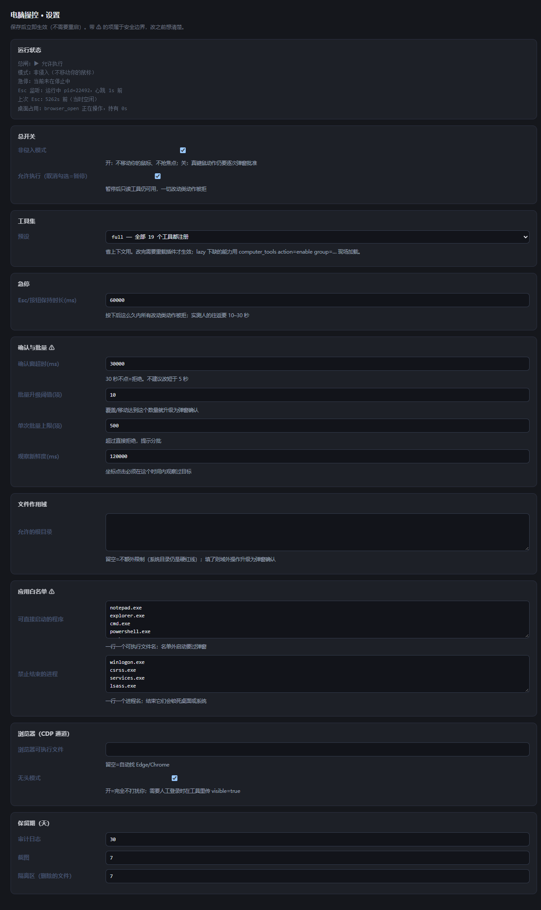
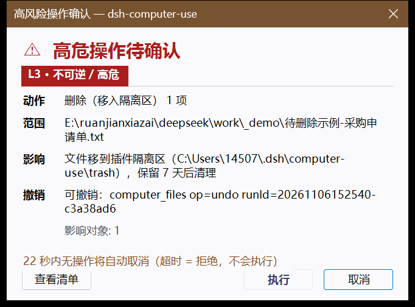

# dsh-computer-use

**Let DeepSeek Harness actually operate this Windows machine — under guardrails.**

Observe → plan → act → verify → log. The mouse stays yours (non-intrusive by default), irreversible steps need a native confirmation dialog, and you can stop a running task at any moment with **Esc** or the on-page button.

> Status: early (0.3.4), Windows only. Requires DeepSeek Harness (DSH) with a `desktop` profile.

## Screens

| Settings page (⚙ bottom-right) | Confirmation dialog for irreversible steps |
|---|---|
|  |  |

Both are real captures: the settings page via the plugin's own CDP channel (`browser_read mode=screenshot fullPage=true`), the dialog from a real `computer_files` delete.


## What it gives the agent

17 tools in four groups:

| Group | Tools |
|---|---|
| Observe | `computer_status`, `computer_windows`, `computer_screenshot` (screenshot + Windows OCR with coordinates), `computer_ui` (tree / find) |
| Act | `computer_ui` (act), `computer_input`, `computer_app`, `computer_files` |
| Govern | `computer_audit`, `computer_pause` |
| Web (CDP) | `browser_status`, `browser_open`, `browser_read`, `browser_act`, `browser_wait`, `browser_close` |

Plus an **Operator contract** injected into the system prompt (risk model, hard red lines, stop conditions, verify-or-it-didn't-happen, output template), and a settings page with an emergency-stop control.

## The two rules it is built around

1. **The user keeps the mouse.** Default mode never moves the physical pointer and never takes keyboard focus: it uses UI Automation patterns (Invoke / ValuePattern / SelectionItem) and posts window messages to the target control. Real `SendInput` is opt-in per call (`allowIntrusive: true`) and requires a confirmation dialog.
2. **Irreversible needs a human.** L3 actions (delete, permanent delete, close window, kill process, paying/sending/submitting, launching a non-whitelisted program) always pop a native modal: full paths, no ellipsis, cancel focused by default, 30 s with no input = deny, and a one-shot digest bound to the exact action and target set.

## Install

```powershell
# from npm (recommended)
dsh plugin --profile web add @li666/dsh-computer-use

# straight from the repository
dsh plugin --profile web add github:mount9527/dsh-computer-use

# from a local checkout (when hacking on it)
git clone https://github.com/mount9527/dsh-computer-use
plugin_manager install_bundle  target=<absolute path to the clone>
```

Use `--profile desktop` instead of `--profile web` on the desktop build.

Then **quit DSH completely and start it again** (closing the window is not enough — it keeps running in the tray), and **refresh the page (F5)** to get the floating stop button.

Requirements: Windows 10/11, Windows PowerShell 5.1, .NET Framework 4.x. OCR needs a Windows OCR language pack (zh-Hans-CN / en-US are common). No native modules, no build step.

## Usage

Just ask. Examples:

- "archive the invoice PDFs in Downloads by month" → `computer_files`
- "read what this dialog says and click 确定" → `computer_ui`
- "fill this form on the site, don't submit" → `browser_*`
- "what changed just now, and can you undo it?" → `computer_audit` + `computer_files op=undo`

Stop any time with **Esc** (or the on-page button). A stop blocks all mutating tools for 60 s; clear it instantly from the same button.

## Platform support

Designed against DSH plugin APIs (`ctx.tools`, `ctx.webServer`, `systemPrompt` sections). It does **not** load on other harnesses (WorkBuddy, Doubao, …) as-is; those would need an MCP-server build plus a per-platform UI adapter.

## Data & privacy

Everything lives in `%DSH_HOME%\computer-use\`: audit JSONL (paths and usernames masked), screenshots, backups, a quarantine folder for deletions, and an isolated browser profile. Deletions go to the quarantine folder and can be undone; only `permanent: true` (behind the L3 dialog) really deletes.

## Credits

MIT. Independent implementation; several techniques were learned from [Yu-tao-Li/dsh-computer-use-win](https://github.com/Yu-tao-Li/dsh-computer-use-win) (MIT) and verified locally — see 参考与致谢 in [README.md](README.md).

## License

MIT
