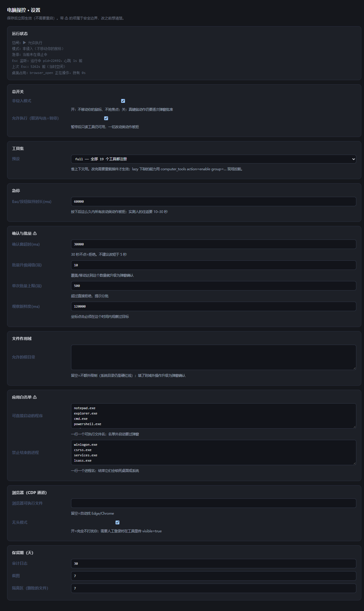
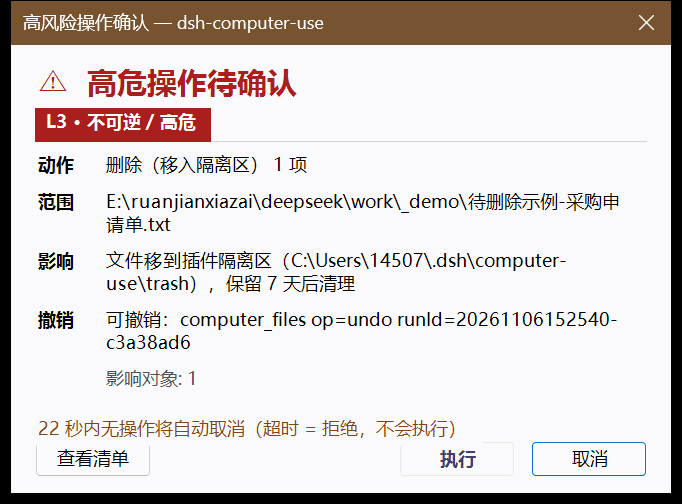

# dsh-computer-use

让 DSH 在这台 Windows 电脑上真正做事：**观察 → 计划 → 执行 → 验证 → 留痕**，高危动作弹原生模态确认。

它不是一个"点一下鼠标"的工具，而是把整套操作纪律固化进了代码里：能结构化就不点坐标，能验证就不假设成功，不可逆的动作必须由你在弹窗上亲手点「执行」。

## 30 秒上手

装完（见[安装](#安装)）之后，**不用记任何工具名**，直接说需求就行：

| 你说 | 它会做 |
|---|---|
| 「看看我这台电脑现在什么状态」 | 报系统、屏幕、前台窗口、能力自检 |
| 「把下载夹里的发票按月份归档」 | 读修改时间 → 按月建目录 → 移动 → 报告并留撤销记录 |
| 「帮我把这个窗口里的『确定』点一下」 | 读控件树 → 用 UI 自动化点它（不碰你的鼠标） |
| 「打开这个网址，把表单填好，别提交」 | 走 CDP 在独立浏览器里操作 |
| 「刚才改了什么？能撤销吗？」 | 读审计 → 按 runId 撤销 |

三条规矩（不需要记，但知道会安心）：

1. **鼠标始终归你**——默认模式不移动指针、不抢焦点；真要模拟键鼠会先弹窗问你
2. **按 Esc 或点页面右下角「停止」**，正在做的事立刻中断，60 秒内不再动你的电脑
3. **不可逆的动作**（删除、关窗口、发送、提交）会弹原生确认窗，你不点它就不动；30 秒不点算拒绝

拿不准时，先让它做只读的事（看看、列出来、读一下），没有任何副作用。

## 界面

| 设置页（页面右下角 ⚙） | 高危动作确认窗（L3） |
|---|---|
|  |  |
| 总开关、工具集预设、急停时长、确认与批量、文件作用域、应用白名单、浏览器通道、保留期 | 动作 / 范围（完整路径）/ 影响 / 撤销方式 / 倒计时，按钮为「查看清单」「执行」「取消」 |

> 两张图都是真机实拍：设置页由插件的 CDP 通道整页截图（`browser_read mode=screenshot fullPage=true`），确认窗是 `computer_files` 删除时的原生模态。

---

## 它做什么

| 工具 | 级别 | 用途 |
|---|---|---|
| `computer_status` | L0 | 环境与能力自检：系统、屏幕、前台窗口、能否注入键鼠、UI 自动化/OCR 是否可用、策略与数据目录 |
| `computer_windows` | L0 | 列可见窗口（句柄/标题/进程/位置/是否前台），GUI 操作的入口 |
| `computer_screenshot` | L0 | 截图（全屏/窗口/矩形）+ Windows OCR 出**带坐标的文字**——纯文本模型读屏的主要方式 |
| `computer_ui` | L0/L1 | UI 自动化：读可访问性树、按 role/name 找元素、对元素执行 invoke/click/setValue/… |
| `computer_wait` | L0 | 等条件成立：等窗口出现、等控件出现、等文件出现/消失。在一个进程里轮询，Esc 可打断 |
| `computer_input` | L1/L2 | 注入键鼠：activate / click / scroll / drag / type（支持中文）/ key |
| `computer_app` | L1/L3 | 启动（白名单内直接启动）、切前台、最小化/最大化/还原、关闭窗口、结束进程 |
| `computer_files` | L1/L3 | 文件批量操作：list（含修改时间/大小）/ mkdir / copy / move / rename / delete / **undo** |
| `computer_audit` | L0 | 读审计日志与可撤销批次 |
| `computer_pause` | L1/L2 | 总闸：一键冻结所有会改动电脑的动作；恢复要过确认窗 |
| `computer_tools` | L0 | 工具集管理：`lite`/`lazy` 预设下查看分组并现场加载需要的工具（无需重载插件） |
| `browser_status` / `browser_open` / `browser_read` / `browser_act` / `browser_wait` / `browser_close` | L0–L3 | 网页自动化（CDP）：页面内操作，不碰系统鼠标键盘，见下文 |

### 工具集预设（省上下文）

17 个工具全量注入对纯聊天会话也是成本。`state.json` 的 `toolMode` 或[设置页](#设置页)可以改成：

| 预设 | 一开始注册 | 适合 |
|---|---|---|
| `full`（默认） | 全部 17 个 | 什么都要干 |
| `lite` | 核心 + 桌面 + 文件（不含浏览器/审计/真键鼠） | 日常文件与窗口操作 |
| `lazy` | 只留 `computer_status` / `computer_pause` / `computer_tools` | 只在需要时才把工具拉进来 |

> `lite`/`lazy` 下缺什么就调 `computer_tools action=enable group=browser`（分组：core / desktop / files / govern / browser），**当场加载，不用重载插件**。
> 只有改 `toolMode` 本身需要重载一次。

除工具之外，它还往系统提示词里注入一段 **Operator 行为契约**（挂在 harness 预留的 `TOOL_COMPUTER_USE` 槽位）：四级风险模型、硬红线、立即停止条件、执行循环、工具选择阶梯、异常降级、输出模板、反模式禁令。

---

## 安全模型

```
L0 只读    截图 / 读文件 / 列窗口 / 读 UI 树        直接执行
L1 可逆    切窗口 / 聚焦 / 滚动 / UIA invoke        直接执行
L2 有副作用 键入 / 点击 / 覆盖文件 / 提交          先说要做什么 → 执行 → 报告
L3 不可逆  删除 / 永久删除 / 关窗 / 杀进程 / 支付    原生模态确认，用户点「执行」才继续
```

**确认通道**（`scripts/desk.ps1` 的 `confirm` 动作）：

- 原生 WinForms 模态窗，`TopMost`，遮罩期间其他动作被 `confirmBusy` 拒绝
- **完整路径/完整清单**，禁止 `...` 省略；批量给「查看清单」（前 20 条 + 总数）
- 三个按钮：`查看清单` / `执行` / `取消`；**默认焦点在「取消」**，`Enter`=取消，`Esc`=取消；「执行」不做主色高亮、且开启 1.2 秒冷静期
- **30 秒无操作 = 拒绝**（`timeout_denied`），不是"默认放行"
- **一次性凭证**：`sha256(动作类型 + 目标指纹 + 参数)` 绑定，执行前重算比对；确认期间目标集合发生变化 → 凭证作废、重新确认（防"所见非所执行"）
- 无交互桌面 / 弹窗失败 → **fail closed**（拒绝，不降级成静默执行）

**代码级硬红线**（不靠模型自觉）：

| 红线 | 实现 |
|---|---|
| 改写系统目录 | `C:\Windows`、`Program Files`、`ProgramData`、盘符根、`~/.dsh` → `policy.redLineReasonForPath` 直接拒绝 |
| 锁屏 / 安全桌面 | `WIN+L`、`Ctrl+Alt+Del`、`Win+R` → `deniedKeyCombo` 拒绝 |
| 密码框键入 | 脚本层用 UIA `IsPassword` 判断焦点元素，命中即拒绝 |
| 盲点坐标 | 没观察过的坐标点 → 拒绝；点击/拖拽必须落在 `expectH` 窗口内（`WindowFromPoint` 实时校验），菜单弹层等 owned popup 例外放行 |
| 错窗口盲打 | `type`/`key` 前强制激活目标窗口并复核前台句柄，不一致即拒绝 |
| 误点隐藏窗 | UIA 元素矩形失效（窗口隐藏/被遮挡）时，点击点不落在目标窗口内 → 拒绝并提示重新读树 |
| 受保护进程 | `explorer/lsass/winlogon/csrss/svchost/dwm` 等拒绝结束 |
| 撤销保障 | L2+ 覆盖前备份原件；删除是**移入隔离区**（可 `undo`），`permanent:true` 才是不可撤销（L3） |

---

## 架构

```
index.js                 宿主半边：17 个工具、风险分级、确认协议、审计、工具集预设、系统提示词
lib/policy.mjs           风险模型 / 红线 / 脱敏 / 凭证摘要
lib/state.mjs            运行期配置（不用 schemastery Config，原因见下）
lib/desk.mjs             子进程桥：一个动词 = 一次 PowerShell，JSON 进 JSON 出
lib/audit.mjs            JSONL 审计 + 保留期清理 + 撤销清单
lib/files.mjs            计划 → 确认 → 执行 → 撤销清单
lib/stop.mjs             急停标记 + Esc 监听进程生命周期
lib/session-lock.mjs     桌面互斥租约（desktop.lock 目录 + owner.json）
lib/messages.mjs         错误码 / errno / CDP 异常的中文词典
lib/browser.mjs          CDP 通道：读 DOM、点击、输入、等待
lib/browser-zh.mjs       浏览器模块的导出边界：统一把英文异常翻成中文
lib/settings-page.mjs    宿主侧渲染的设置页（自包含 HTML，无构建步骤）
lib/cdp.mjs              极简 CDP 客户端（Node 内置 WebSocket）
scripts/desk.ps1         Windows 桌面执行体：P/Invoke + UI Automation + WinRT OCR + WinForms 弹窗
scripts/stop-watch.ps1   常驻 Esc 监听（只观察不吞键，写停止标记 + 心跳）
scripts/selftest-target.ps1  自检靶子（不碰你的数据），用来验证键鼠注入链路
test/*.mjs               四个单测：急停规则 / 设置页 / 桌面互斥 / 错误中文化
```

**为什么桌面动作要另起 PowerShell 子进程？**
DSH 的 `pwsh` / `bash` 工具跑在**低完整性级别（Low IL）**的沙箱里。实测：那种进程里 `SetCursorPos` / `SetForegroundWindow` 一律失败，UI Automation 也只能看到 HWND 层级、读不到跨进程控件。插件代码运行在宿主进程（正常完整性级别），它派生的子进程同样正常，所以：**结构化读屏、注入键鼠、弹原生模态**这三件事只能在这里做。

**为什么不声明 `schemastery` Config？**
本地目录安装是符号链接，插件目录解析不到 asar 内的 `@deepseek-ai/*` 包；声明 `Config` 会让插件在装配阶段直接失败。配置改用自己的 `state.json`（见下）。

---

## 安装

```powershell
# 在 DSH 里用插件管理器安装（推荐）
plugin_manager install_bundle  target=E:\ruanjianxiazai\deepseek\work\dsh-computer-use
```

装完即生效（新增 bundle 走 HMR）。改了 `index.js` / `lib/*.mjs` 之后热重载：

```powershell
plugin_manager set_plugin target='include:dsh-computer-use' enabled=false
plugin_manager set_plugin target='include:dsh-computer-use' enabled=true
```

只改 `scripts/desk.ps1` 不需要重载——每次调用都会重新读脚本。

**环境要求**：Windows 10/11 + Windows PowerShell 5.1（系统自带）+ .NET Framework 4.x。OCR 需要系统装了对应语言的 OCR 语言包（中文系统默认有 `zh-Hans-CN`）。没有原生弹窗能力的环境（无交互桌面）会 fail closed。

## 装好之后

1. **完全退出 DSH 再打开**（只关窗口不够，它还在托盘里跑，不会加载新插件）
2. **刷新页面（F5）** —— 右下角会出现「● 停止」和「⚙ 设置」两个浮钮
3. 让 agent 调一次 `computer_status`，确认这行：`能力：UI 自动化=可用 OCR=可用 原生弹窗=可用 鼠标键盘注入=可用`

## 设置页

页面右下角「⚙」，或直接访问插件路由 `/settings`（前缀每次激活不同，`computer_status` 里能看到当前值）。可以改：

| 分组 | 项 |
|---|---|
| 总开关 | 非侵入模式 / 允许执行（暂停） |
| 急停 | Esc 与按钮的保持时长 |
| 确认与批量 ⚠ | 确认窗超时、批量升级阈值、单次批量上限、观察新鲜度 |
| 文件作用域 | 允许的根目录（留空=不额外限制，系统目录仍是硬红线） |
| 应用白名单 ⚠ | 可直接启动的程序、禁止结束的进程 |
| 浏览器 | 可执行文件路径、无头模式 |
| 保留期 | 审计日志 / 截图 / 隔离区 |

保存即时生效（不用重启），带范围校验与裁剪；**安全边界不会被设置页关掉**。同一页还显示运行状态：总闸、模式、急停状态、Esc 监听心跳、上次 Esc。

---

## 平台支持（发布前必须知道）

本插件是针对 **DSH 插件 API** 写的（`ctx.tools` / `ctx.webServer` / `systemPrompt` 槽位 / `plugin_manager` 安装方式）。

| 平台 | 能否直接用 |
|---|---|
| DSH Desktop（`desktop` profile） | ✅ 本插件的目标环境 |
| DSH Web / CLI（有 `tools` + `webServer` 服务的 profile） | ✅ 可用；停止/设置按钮依赖 `webServer.tapIndex`，缺失时只影响浮钮，不影响工具本身 |
| WorkBuddy / 豆包 等其它 harness | ❌ **装不上**。要支持必须改成 **MCP server** 形态，UI 与停止通道再按平台单独适配 |

---

## 配置（`%DSH_HOME%\computer-use\state.json`）

```json
{
  "paused": false,                // 总闸；true 时只读工具仍可用
  "nonIntrusive": true,           // 默认不移动物理指针、不抢键盘焦点
  "toolMode": "full",             // full / lite / lazy（改这个要重载插件）
  "stopHoldMs": 60000,            // 一次 Esc / 按钮点击保持多久（改动类动作被拒）
  "confirmTimeoutMs": 30000,      // 弹窗超时 = 拒绝；confirmEnabled 恒为 true（关不掉）
  "allowedApps": ["notepad.exe", "..."],   // launch 白名单；名单外要过 L3 弹窗
  "protectedProcesses": ["explorer.exe", "..."],
  "allowRoots": [],               // 空 = 不额外限制（系统目录仍是硬红线）；填了则域外操作升级确认
  "observationTtlMs": 120000,     // 坐标点击的观察新鲜度
  "bulkThreshold": 10,            // ≥N 项的覆盖/移动升级为弹窗确认
  "maxBatch": 500,                // 单次批量上限，超过直接拒绝
  "browser": { "exePath": "", "headless": true },  // 留空=自动找 Edge/Chrome
  "logRetentionDays": 30, "shotRetentionDays": 7, "trashRetentionDays": 7
}
```

数据目录 `%DSH_HOME%\computer-use\`：

```
state.json     配置与总闸
logs/          audit-YYYYMMDD.jsonl（每个动作一行，已脱敏：用户名→<user>、token→<redacted>）
shots/         截图（按保留期清理）
backups/<runId>/   覆盖前的原件 + manifest.json（撤销清单）
trash/<runId>/     删除的文件（不是真删，可 undo）
run/           子进程临时交换文件（用后即删）
```

---

## 自检（改完 `desk.ps1` 后建议跑一遍）

```text
1) computer_app  action=launch exe=powershell.exe
     args=["-NoProfile","-ExecutionPolicy","Bypass","-File",
           "<插件目录>\scripts\selftest-target.ps1","-Out","<临时目录>\cu-selftest"]
2) computer_input actions=[{type:"activate", h:"0x..."},
                           {type:"click", x:.., y:.., expectH:"0x..."}]
3) 读 <临时目录>\cu-selftest.tbclick   → 出现 "textbox-clicked" 说明点击命中
   读 <临时目录>\cu-selftest.txt       → 出现你键入的文本（含中文）说明注入正常
```

---

## 操作模式：鼠标归你（非侵入优先）

插件干活的时候，**你的鼠标和键盘必须还能用**——这是默认行为，不是可选项。

| | 非侵入（默认） | 接管（需你点弹窗批准） |
|---|---|---|
| 怎么点 | 控件自己的 UI 自动化模式（Invoke / ValuePattern / SelectionItem…），或把 `WM_LBUTTONDOWN` / `BM_CLICK` **消息直送控件自己的窗口** | `SetCursorPos` + `SendInput`：移动物理光标、抢键盘焦点 |
| 你的鼠标 | 不受影响，可以同时用 | 被占用，动作期间你抢不回来 |
| 你的键盘焦点 | 不变（可以往后台窗口打字） | 被抢走 |
| 适用 | 原生控件（WinForms/WPF/Win32/多数桌面软件） | 没有结构化接口的界面（Chromium 网页内容等） |
| 怎么触发 | 直接调 `computer_ui mode=act` | `computer_ui allowIntrusive=true` 或 `computer_input allowIntrusive=true` → 弹原生确认窗，你点「执行」才接管 |

`state.json` 里的 `nonIntrusive` 默认 `true`；`computer_input`（真键鼠）在这个模式下**整体被拒绝**，除非显式 `allowIntrusive=true` 并通过确认窗。

每次 `computer_ui act` 的回复里都会写出**走的哪条通道**，并在动作前后各采样一次光标位置：

```
已执行 click → 1  wm-BM_CLICK
通道：非侵入 · 窗口消息直送控件（未调用任何指针 API）
鼠标指针：298,823 → 49,701（非侵入通道不调用 SetCursorPos / SendInput：这段位移是你自己动鼠标留下的）
```

**能力边界**：非侵入的前提是目标控件"有可编程入口"——要么支持 UI 自动化模式，要么有自己的窗口句柄。原生控件基本都有；**Chromium/Electron 的网页内容两者都没有**，所以网页里的按钮在非侵入模式下点不动，只能：① 接管模式（逐次批准），或 ② 走浏览器自动化（见下）。截图 + OCR 只是**看**，不会动鼠标，任何模式下都安全。

---

## 浏览网页 / 在网页里做操作（browser_*，CDP）

网页任务走 **Chrome DevTools 协议**，在页面内部完成操作：**不碰操作系统层面的鼠标键盘，也不碰你正在用的浏览器**。

| 工具 | 用途 |
|---|---|
| `browser_status` | 是否已启动、版本、当前页面、隔离配置目录 |
| `browser_open` | 启动/复用隔离浏览器并打开 URL（默认**无头**，不弹窗不抢焦点；`visible=true` 才开可见窗口，用于人工登录） |
| `browser_read` | `mode=text` 读正文与链接；`mode=elements` 列出可交互元素及**稳定 CSS 选择器**；`mode=screenshot` 页面截图（可 `ocr=true`） |
| `browser_act` | `click` / `type` / `select` / `check` / `press` / `scroll` / `back` / `reload` |
| `browser_wait` | 等选择器出现 / 等文本出现（异步加载不要靠猜） |
| `browser_close` | 关掉隔离实例（不动你自己的浏览器） |

**隔离性**：用的是插件自己的 profile 目录（`%DSH_HOME%\computer-use\browser-profile`），和你日常 Edge/Chrome 的书签、标签、登录态完全分开。要登录某个站点时：`browser_open visible=true` 打开一次可见窗口，你亲手登录，之后无头模式复用这份登录态。

**为什么这条路最稳**：读的是 DOM 而不是像素，选择器不会因为窗口大小/DPI/遮挡失效；`browser_read mode=elements` 会给出 `#id` 或 `meta[name=...]` 或 `:nth-of-type` 路径，直接喂给 `browser_act` 即可。

**风险闸门**：点击/回车命中「提交/删除/发送/支付」这类不可逆语义（元素文本或 `intent` 里出现），会弹原生确认窗；密码框一律拒绝写入。

> 关于"在线测评/笔试"类：技术上可以识别题目并作答，但代替本人参加考试/测评属于作弊，我不会做。可以把题目和答案整理成稿，由你自己提交。

### 网页 vs 桌面，怎么选

- 有 URL 能打开 → `browser_*`（隔离、无头、不打扰你）
- 只存在于本机软件里，或要操作**你自己开着的浏览器** → `computer_ui`（非侵入，走控件自身的 UIA/窗口消息 + Chromium 预热）
- 连控件都没有（canvas、自绘界面、iframe 内部）→ 最后才 `computer_input` 接管真键鼠，并且要你点确认

### Chromium 预热：让 Edge/Chrome 的网页对 UIA 可见

Chromium 只有在有 UIA 客户端"问过"页面之后才构建无障碍树。`computer_ui` 在读写前会自动预热，两种形态都试：

- 老式 / Electron / CEF / WebView2：读 `Chrome_RenderWidgetHostHWND` 子窗口的属性（这条是参考 dsh-computer-use-win 的做法）
- **当前 Edge/Chrome（实测 Edge 156 已不再提供该子窗口，只剩 `Intermediate D3D Window`）**：沿宿主窗格下探读取属性

结果如实写在回复里：

```
网页内容（Chromium 预热）：0 个渲染器 · 通道 tree · 已就绪 · 等待 420ms
```

`ready` 已就绪 / `starting` 还在生成（稍后重读一次）/ `hidden` 窗口最小化或不可见（先恢复窗口，最小化时没有可唤醒的页面树）/ `unresponsive` 窗口无响应（别硬试，UIA 调用可能卡住）。

**实测对比（同一台机器、同一个 Edge 窗口）**：预热前 `tree` 只有 3 个匿名节点、`find` 命中 0；预热后能读到 `返回/前进/刷新/新建标签页/关闭标签页`、地址栏，以及网页根节点 `Document "标题" #RootWebArea = "https://页面地址"`，深层还能读到页面里的链接与输入框。网页内部仍然建议走 `browser_*`（CDP 读 DOM 更细），UIA 这条路适合"操作你已经开着的那个浏览器窗口"。

---

## 错误信息：一律中文

内部标识（错误码、errno、CDP 异常）不直接抛给用户。桌面执行体只吐**稳定的错误码**，中文放在 Node 侧的词典里：

```
UI 动作失败：窗口句柄无效或已经关闭（技术细节：0xdeadbeef）
下一步：窗口可能已经关掉了：用 computer_windows 重新找一次
```

- 为什么不在 `desk.ps1` 里写中文：Windows PowerShell 5.1 把**无 BOM** 的 UTF-8 脚本按 ANSI 读，中文会变乱码并让解析失败。脚本保持纯 ASCII，只输出错误码
- 三类来源都覆盖：`desk.ps1` 的 14 个错误码（`lib/messages.mjs`）、fs 的 errno（ENOENT/EPERM/EBUSY…）、浏览器/CDP 的英文异常（`Target closed`、`Execution context was destroyed`…）
- 原始英文保留在「技术细节 / 原始信息」里，方便排查，但不占主句
- 已经是中文的信息原样保留，不会套两层前缀
- 验证：`node test/messages.mjs`（29 项）
---

## 桌面互斥（多会话不打架）

插件实例是**进程级共享**的：两个会话同时调 `computer_ui act` / `computer_input`，结果就是抢鼠标、抢前台、互相把对方的窗口切走，两边的"已验证"结论都会失真。

所以**会改动共享外部状态的调用要拿一把全局租约**：

| 拿锁 | 不拿锁（只读观察） |
|---|---|
| `computer_ui mode=act`、`computer_input`、`computer_app`、`computer_files` 的写操作、`browser_open/act/close` | `computer_status`、`computer_windows`、`computer_screenshot`、`computer_ui tree/find`、`computer_wait`、`computer_audit`、`browser_read/wait` |

- 实现：`%DSH_HOME%\computer-use\desktop.lock\` 目录 + `owner.json`。**建目录**是 Windows 上的原子操作，比"先检查文件再创建"可靠
- 同一会话连续操作是**续租**，不会自锁
- 占用时另一个会话收到：`【桌面被占用】另一个会话正在操作这台电脑：computer_app（agent session-79ab…，已占用 3 秒，租约还剩 117 秒）`——这是**结论**，模型不会重试
- 租约 120 秒过期可被抢占；插件启动时会清掉上次崩溃留下的死锁；损坏的 `owner.json` 或空锁目录都按"过期"处理
- `computer_status` 与设置页都能看到：`桌面占用：空闲` / `桌面占用：computer_app 正在操作（持有 3 秒…）`

**验证方式**：`node test/session-lock.mjs`（12 项：抢占、续租、非持有人不能释放、过期抢占、损坏/空锁接管、活跃锁不被清）。真并发也实测过——子 agent 在另一个会话里发起 `computer_files mkdir`，当场被 `computer_app` 的租约挡住。
---

## 急停：Esc 键 / 页面上的停止按钮

**两条通道，同一件事**：都只写一个停止标记（`%DSH_HOME%\computer-use\stop.json`），
插件入口、`desk.ps1` 的长循环、确认弹窗的计时器都会读它 —— 所以它打断的是**正在做的事**，而不只是拦住"下一件事"。

| 通道 | 怎么用 | 实现 |
|---|---|---|
| **Esc 键** | 直接按 Esc | 常驻的 `scripts/stop-watch.ps1` 轮询 `GetAsyncKeyState`：**只观察不吞键**，Esc 在别的程序里照常好用；用 `RegisterHotKey` 会抢走全局 Esc，用键盘钩子又像键盘记录器，所以都不用 |
| **页面按钮** | 页面右下方的「停止」圆钮 | 插件注册 `/dsh-cu-<随机>/stop|resume|status` 三个接口，并通过 `webServer.tapIndex` 往页面注入一个浮动按钮；停止后按钮变红显示「已停止 · 继续」，点它就是恢复 |

**行为**

- **任何一次 Esc / 按钮点击都算停止，保持 60 秒**（`stopHoldMs`）：正在跑的动作会被打断，之后 60 秒内所有改动类动作被拒
- 为什么不再区分"空闲/忙"：实测从你按下到 agent 发起下一次工具调用要 **10–30 秒**，任何比这更短的窗口都会让你觉得"按了没反应"
- 打断粒度：UIA 遍历每 40 个节点、批量输入每个动作之间、确认弹窗每秒、`computer_wait` 每次轮询 —— 都会检查一次停止标记
- 不会永久冻结：到期自动恢复；想立刻继续就点按钮上的「继续」
- **监听进程自检与自愈**：每次工具调用都会检查监听是否存活，死了重新拉起；它每 2 秒写一次心跳，异常写进 `stop-watch.log`
- 状态里能看到全部证据：
  `急停：Esc 监听运行中（pid=19332，心跳 1s 前） · 上次 Esc 12s 前（当时正在做事），一次 Esc 保持 60 秒 · 当前未在停止中 · 页面按钮：/dsh-cu-kurqc8/stop`
- 彻底停用（长期冻结）仍然用 `computer_pause` 总闸 —— 两者分工：急停管"这一阵停住"，总闸管"一直别动"

**留下了哪些证据**（都在 `%DSH_HOME%\computer-use\`）

| 文件 | 作用 |
|---|---|
| `stop.json` | 停止标记：`{at, source, armed}`，工具与 `desk.ps1` 都读它 |
| `last-esc.json` | 最近一次 Esc 的记录（含 armed），用来区分"没检测到"和"检测到了但按规则忽略" |
| `stop-watch.heartbeat` | 监听进程心跳，2 秒一次 |
| `stop-watch.log` | 监听进程的异常输出（以前它悄悄死过一次，没有任何证据） |

**注意**：页面按钮是通过改写首页 HTML 注入的，装好/更新插件后需要**刷新一次页面（F5）**才会出现。路由注册失败不会连累工具与 Esc 通道（`computer_status` 会写明原因）。

**验证方式**

```text
computer_status                                  → 看「急停」那行的监听 pid、心跳、上次 Esc
按一次 Esc，再看 computer_status                  → 「上次 Esc Ns 前（当时任务中/空闲…）」+「当前在停止中」
任意改动类工具（如 computer_files mkdir）        → 被拒绝："【已停止】用户按下了停止（来源：esc）…"
POST <endpoint 前缀>/resume                      → 立刻清除，工具恢复
node test/stop-rules.mjs                         → 9 项判定规则单测（60 秒窗口 / 过期 / 旧格式 / 往返延迟）
```

---

## 参考与致谢

本插件为独立实现，以下做法参考了 [Yu-tao-Li/dsh-computer-use-win](https://github.com/Yu-tao-Li/dsh-computer-use-win)（MIT，基于 [cgissing/windows-computer-use](https://github.com/cgissing/windows-computer-use) 衍生）的公开实现与文档，并在本机重新验证后才落地：

| 借鉴点 | 落在哪 | 说明 |
|---|---|---|
| Chromium 页面树按需预热 | `scripts/desk.ps1` `Start-ChromiumWebContent` | 并补充了"现代 Chromium 没有 RenderWidgetHost 子窗口"时的下探式预热 |
| 真实输入后**归还指针与前台**（用户动过鼠标就不改回去） | `Restore-Borrowed` | 与其 `Complete-Input` 思路一致 |
| `verification: sent / observed` 两级语义 | `computer_ui act` / `computer_input` 返回 | "输入已送达"≠"任务完成" |
| 启动程序不抢前台 | `window action=show`（`SW_SHOWNOACTIVATE` + `SWP_NOACTIVATE`） | 对应其"不把窗口切到前台" |
| 未命名布局窗格不吃深度预算 | `Build-Tree` 的 `fw` 判定 | 否则窗口级遍历到不了网页 |

未采纳：MCP 服务化架构、25 工具集、思考浮窗与工具预设懒加载。

**Esc 立即停止**：对方做得比本插件好，已补齐（见上文「急停」）。区别：对方是独立进程 + 键盘钩子监听并直接取消后端调用；本插件用 `GetAsyncKeyState` 轮询（不吞键）+ 共享停止标记，`desk.ps1` 在长循环里协作式检查。按钮通道是本插件额外加的。

---

## 已知边界

- **Chromium 系应用（Edge/Electron）的网页内容**：已支持（见上文"Chromium 预热"），但最小化的窗口没有可唤醒的页面树，深层页面元素也建议走 `browser_*`。读不到时用 `computer_screenshot` + OCR 兜底。
- **坐标是物理像素**：插件进程声明了 per-monitor DPI 感知，所以截图、UIA 矩形、鼠标坐标三者一致；但被操作的 DPI-unaware 程序内部布局可能和它的自报坐标不一致——以截图/OCR 的坐标为准。
- **前台锁**：Windows 不允许后台进程随意抢焦点。激活走 `AttachThreadInput` 技巧，多数情况有效；失败时会明确报错，绝不盲打。
- **弹窗只能由人点**。工具不会、也无法自己点自己的确认窗（这是设计目标，不是缺陷）。`state.json` 是用户可写的，所以"防的是模型，不是用户本人"。
- **桌面是独占的**：一次只允许一个会话改动电脑（见「桌面互斥」）；两个会话同时操作会互相点错地方。
- 目前只支持 Windows；macOS/Linux 需要另写一份 `desk` 执行体（接口是动词 + JSON）。
